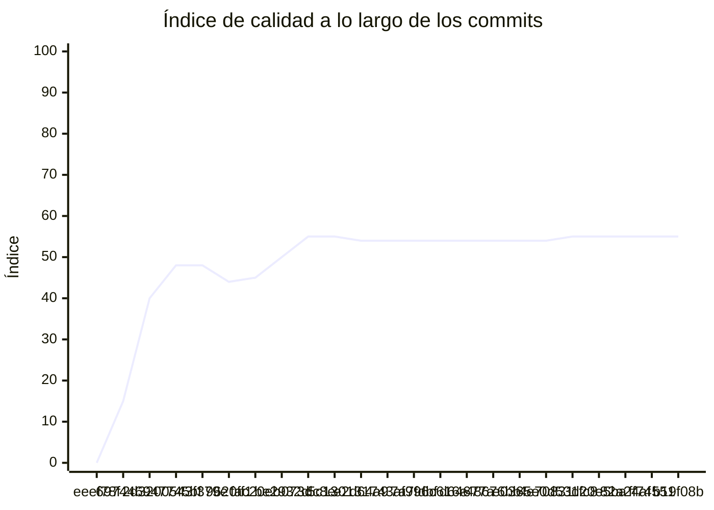

<!-- evaluacion:inicio -->
# Evaluación — prog-2-SQR/Backend-Turnos

> Documento **generado automáticamente** por la cátedra de Programación II (UM): RepoSense + análisis de calidad de **7 dimensiones**. **No editar a mano**: se regenera en cada evaluación.
> Rama evaluada: `main`. Análisis **heurístico** (regex + métricas) + build: es una criba para orientar la revisión, **no una nota**. La **documentación** del repositorio no se evalúa.
> Generado: 2026-11-11.

## 1. Veredicto

| Aspecto | Resultado |
|---|---|
| Índice de calidad | **66/100** |
| Tipo de repositorio | `backend` |
| Build (`mvnw verify` / `gradlew check`) | OK |
| Código (LOC) | 9,368 |
| Archivos de código | 230 |
| Clases | 236 |
| Código dentro de clases (%POO) | 65% |
| Funciones fuera de clases | 7 |
| Duplicación (puerta) | 0.6% |
| Duplicación lógica | 0.6% |
| Duplicación de boilerplate | 20.4% |
| Cobertura | 99% |
| Tope duro aplicado a D1 | `SUELTAS>=3` → D1 ≤ 40 |

> Este informe **describe** lo que el análisis midió con los criterios ya establecidos de la materia. No es una nota.

## 2. Semáforo de aprobación

Criterios de la cátedra (`CRITERIOS-CALIDAD.md`): **Aprobar** se juega con el perfil `estandar`; **destacar**, con el `exigente` (meta de excelencia).

| Semáforo | Resultado |
|---|---|
| Aprobar (`estandar`) | **no cumple** — 6/11 |
| Destacar (`exigente`) | **no cumple** — 5/11 |

**Para aprobar, falta cumplir:** SOLID; SEC

**Para destacar, falta cumplir:** SOLID; POO; SEC

## 3. Autoría (RepoSense)

| Autor | Commits | Código (LOC) | Tests (LOC) | Docs (LOC) | Días activos | % del código |
|---|---:|---:|---:|---:|---:|---:|
| Santiago Quiroga Rivarossa | 73 | 5,164 | 5,942 | 774 | 13 | 100% |

> _El LOC de autoría lo calcula RepoSense sobre el historial y puede diferir del LOC de código del análisis (que mira el estado de `main`)._

## 4. Dimensiones evaluadas

Cada dimensión indica **qué mide**, **por qué importa** y **tu resultado**. Cuando el puntaje queda por debajo de la referencia, se agregan preguntas para **investigar la causa** (no hay recetas).

| Dimensión | Peso | Puntaje |
|:--|--:|--:|
| **D1** Diseño OO, SOLID y patrones (20%) | 20% | 2 |
| **D2** Arquitectura hexagonal — backend (15%) | 15% | 100 |
| **D3** Frontend KMP: MVVM y buenas prácticas (10%) | 10% | N/A |
| **D4** Integración y contrato (10%) | 10% | 90 |
| **D5** Seguridad y robustez (10%) | 10% | 0 |
| **D6** Pruebas y cobertura (20%) | 20% | 100 |
| **D7** Proceso y entrega (15%) | 15% | 100 |

### D1. Diseño OO, SOLID y patrones (20%)

- **Qué mide:** Métricas orientadas a objetos (clases, métodos, campos, cohesión, acoplamiento, herencia) y proxies de SOLID, más patrones de diseño.
- **Por qué importa:** El eje de la materia es el buen uso de la POO y su arquitectura: un diseño con clases claras y poco acopladas es más fácil de entender, probar y cambiar.
- **Tu resultado:** **2/100**
- **Para investigar la causa:**
    - ¿Se pensó el modelo de clases antes de codificar o se agrupó después?
    - ¿Qué clases concentran muchas responsabilidades a la vez?
    - ¿Los colaboradores llegan como parámetros o se crean por dentro?

### D2. Arquitectura hexagonal — backend (15%)

- **Qué mide:** Separación en capas (dominio, puertos de entrada/salida, adaptadores) y dirección de las dependencias del backend.
- **Por qué importa:** Aislar el dominio de la infraestructura permite cambiar la base de datos, el framework o el transporte sin tocar las reglas de negocio.
- **Tu resultado:** **100/100**

### D4. Integración y contrato (10%)

- **Qué mide:** Cumplimiento del contrato de integración de la cátedra (formato de errores, paginación, autenticación, endpoints esperados).
- **Por qué importa:** Los servicios deben poder integrarse entre sí y con la app sin sorpresas; el contrato es lo que hacen cumplir las pruebas de integración.
- **Tu resultado:** **90/100**

### D5. Seguridad y robustez (10%)

- **Qué mide:** Credenciales embebidas, consultas SQL por concatenación, y presencia de config de entorno; aislamiento de secretos.
- **Por qué importa:** Un secreto en el repositorio o una consulta construida por concatenación son riesgos concretos, no hipotéticos.
- **Tu resultado:** **0/100**
- **Para investigar la causa:**
    - ¿De dónde salen las credenciales que usa el sistema?
    - ¿Qué consultas se arman con texto en vez de parámetros?
    - ¿Qué pasa si falta una variable de entorno al arrancar?

### D6. Pruebas y cobertura (20%)

- **Qué mide:** Cantidad y resultado de pruebas y cobertura de línea (JaCoCo/Kover, Surefire/Failsafe) cuando hay build.
- **Por qué importa:** Las pruebas son la red de seguridad para refactorizar e integrar; la cobertura acota las zonas sin verificar.
- **Tu resultado:** **100/100**

### D7. Proceso y entrega (15%)

- **Qué mide:** Artefactos verificables de proceso/entrega: `compose`, `.env.example`, CI (`.github/workflows/`), `CODEOWNERS` y wrapper de build (`mvnw`/`gradlew`). **No** puntúa documentación.
- **Por qué importa:** Un proyecto que compila, se levanta y se valida solo es más fácil de revisar y de integrar en equipo.
- **Tu resultado:** **100/100**

## 5. Señales detectadas

El análisis encontró las siguientes señales (archivo, sin número de línea a propósito):

**DIP/concretos** (100)
- clase 'AuthenticationManagerCredentialsChecker' muy acoplada (CBO=14) — `src/main/java/ar/edu/um/prog2/quiroga/turnos/auth/infrastructure/security/AuthenticationManagerCredentialsChecker.java`
- clase 'JwtTokenIssuer' muy acoplada (CBO=17) — `src/main/java/ar/edu/um/prog2/quiroga/turnos/auth/infrastructure/security/JwtTokenIssuer.java`
- clase 'AuthController' muy acoplada (CBO=13) — `src/main/java/ar/edu/um/prog2/quiroga/turnos/auth/infrastructure/web/controller/AuthController.java`
- clase 'JpaReservationProcessRepositoryAdapter' muy acoplada (CBO=18) — `src/main/java/ar/edu/um/prog2/quiroga/turnos/reservation/infrastructure/persistence/adapter/JpaReservationProcessRepositoryAdapter.java`
- clase 'KafkaPhoneSubmissionPublisher' muy acoplada (CBO=15) — `src/main/java/ar/edu/um/prog2/quiroga/turnos/reservation/infrastructure/messaging/publisher/KafkaPhoneSubmissionPublisher.java`
- clase 'ReservationActionsListener' muy acoplada (CBO=24) — `src/main/java/ar/edu/um/prog2/quiroga/turnos/reservation/infrastructure/messaging/listener/ReservationActionsListener.java`
- clase 'CatedraHoldClientAdapter' muy acoplada (CBO=17) — `src/main/java/ar/edu/um/prog2/quiroga/turnos/reservation/infrastructure/client/adapter/CatedraHoldClientAdapter.java`
- clase 'CatedraErrors' muy acoplada (CBO=11) — `src/main/java/ar/edu/um/prog2/quiroga/turnos/reservation/infrastructure/client/adapter/CatedraErrors.java`
- clase 'CatedraReservationClientAdapter' muy acoplada (CBO=13) — `src/main/java/ar/edu/um/prog2/quiroga/turnos/reservation/infrastructure/client/adapter/CatedraReservationClientAdapter.java`
- clase 'ReservationController' muy acoplada (CBO=17) — `src/main/java/ar/edu/um/prog2/quiroga/turnos/reservation/infrastructure/web/controller/ReservationController.java`
- clase 'ReservationExceptionHandler' muy acoplada (CBO=29) — `src/main/java/ar/edu/um/prog2/quiroga/turnos/reservation/infrastructure/web/handler/ReservationExceptionHandler.java`
- clase 'ReservationService' muy acoplada (CBO=18) — `src/main/java/ar/edu/um/prog2/quiroga/turnos/reservation/application/service/ReservationService.java`
- clase 'CancelReservationUseCaseImpl' muy acoplada (CBO=16) — `src/main/java/ar/edu/um/prog2/quiroga/turnos/reservation/application/usecases/CancelReservationUseCaseImpl.java`
- clase 'StartReservationUseCaseImpl' muy acoplada (CBO=23) — `src/main/java/ar/edu/um/prog2/quiroga/turnos/reservation/application/usecases/StartReservationUseCaseImpl.java`
- clase 'StartReservationUseCaseImpl' instancia 3 concretos (CBO=23) — `src/main/java/ar/edu/um/prog2/quiroga/turnos/reservation/application/usecases/StartReservationUseCaseImpl.java`
- clase 'HandleReservationResultUseCaseImpl' muy acoplada (CBO=11) — `src/main/java/ar/edu/um/prog2/quiroga/turnos/reservation/application/usecases/HandleReservationResultUseCaseImpl.java`
- clase 'ReconcileReservationsUseCaseImpl' muy acoplada (CBO=9) — `src/main/java/ar/edu/um/prog2/quiroga/turnos/reservation/application/usecases/ReconcileReservationsUseCaseImpl.java`
- clase 'SubmitPhoneUseCaseImpl' muy acoplada (CBO=18) — `src/main/java/ar/edu/um/prog2/quiroga/turnos/reservation/application/usecases/SubmitPhoneUseCaseImpl.java`
- clase 'SubmitPhoneUseCaseImpl' instancia 3 concretos (CBO=18) — `src/main/java/ar/edu/um/prog2/quiroga/turnos/reservation/application/usecases/SubmitPhoneUseCaseImpl.java`
- clase 'HandlePhoneRequestUseCaseImpl' muy acoplada (CBO=12) — `src/main/java/ar/edu/um/prog2/quiroga/turnos/reservation/application/usecases/HandlePhoneRequestUseCaseImpl.java`
- clase 'ReservationProcessRepository' muy acoplada (CBO=9) — `src/main/java/ar/edu/um/prog2/quiroga/turnos/reservation/domain/ports/out/ReservationProcessRepository.java`
- clase 'ReservationResultType' muy acoplada (CBO=12) — `src/main/java/ar/edu/um/prog2/quiroga/turnos/reservation/domain/model/ReservationResultType.java`
- clase 'ReservationProcess' muy acoplada (CBO=34) — `src/main/java/ar/edu/um/prog2/quiroga/turnos/reservation/domain/model/ReservationProcess.java`
- clase 'ReservationStatus' muy acoplada (CBO=19) — `src/main/java/ar/edu/um/prog2/quiroga/turnos/reservation/domain/model/ReservationStatus.java`
- clase 'CatalogClientAdapter' muy acoplada (CBO=18) — `src/main/java/ar/edu/um/prog2/quiroga/turnos/availability/infrastructure/client/adapter/CatalogClientAdapter.java`
- clase 'CatedraOccupancyClientAdapter' muy acoplada (CBO=13) — `src/main/java/ar/edu/um/prog2/quiroga/turnos/availability/infrastructure/client/adapter/CatedraOccupancyClientAdapter.java`
- clase 'AvailabilityController' muy acoplada (CBO=13) — `src/main/java/ar/edu/um/prog2/quiroga/turnos/availability/infrastructure/web/controller/AvailabilityController.java`
- clase 'AvailabilityExceptionHandler' muy acoplada (CBO=16) — `src/main/java/ar/edu/um/prog2/quiroga/turnos/availability/infrastructure/web/handler/AvailabilityExceptionHandler.java`
- clase 'GetAvailabilityUseCaseImpl' muy acoplada (CBO=17) — `src/main/java/ar/edu/um/prog2/quiroga/turnos/availability/application/usecases/GetAvailabilityUseCaseImpl.java`
- clase 'GetAvailabilityUseCaseImpl' instancia 3 concretos (CBO=17) — `src/main/java/ar/edu/um/prog2/quiroga/turnos/availability/application/usecases/GetAvailabilityUseCaseImpl.java`
- clase 'WeeklySchedule' muy acoplada (CBO=9) — `src/main/java/ar/edu/um/prog2/quiroga/turnos/availability/domain/model/WeeklySchedule.java`
- clase 'Availability' muy acoplada (CBO=8) — `src/main/java/ar/edu/um/prog2/quiroga/turnos/availability/domain/model/Availability.java`
- clase 'HttpClientsConfig' muy acoplada (CBO=30) — `src/main/java/ar/edu/um/prog2/quiroga/turnos/config/HttpClientsConfig.java`
- clase 'HttpClientsConfig' instancia 3 concretos (CBO=30) — `src/main/java/ar/edu/um/prog2/quiroga/turnos/config/HttpClientsConfig.java`
- clase 'JwtConfig' muy acoplada (CBO=17) — `src/main/java/ar/edu/um/prog2/quiroga/turnos/shared/security/JwtConfig.java`
- clase 'JwtConfig' instancia 5 concretos (CBO=17) — `src/main/java/ar/edu/um/prog2/quiroga/turnos/shared/security/JwtConfig.java`
- clase 'SecurityConfig' muy acoplada (CBO=15) — `src/main/java/ar/edu/um/prog2/quiroga/turnos/shared/security/SecurityConfig.java`
- clase 'GlobalExceptionHandler' muy acoplada (CBO=23) — `src/main/java/ar/edu/um/prog2/quiroga/turnos/shared/web/GlobalExceptionHandler.java`
- clase 'UserDetailsServiceAdapter' muy acoplada (CBO=11) — `src/main/java/ar/edu/um/prog2/quiroga/turnos/user/infrastructure/security/UserDetailsServiceAdapter.java`
- clase 'UserController' muy acoplada (CBO=11) — `src/main/java/ar/edu/um/prog2/quiroga/turnos/user/infrastructure/web/controller/UserController.java`
- clase 'UserExceptionHandler' muy acoplada (CBO=9) — `src/main/java/ar/edu/um/prog2/quiroga/turnos/user/infrastructure/web/handler/UserExceptionHandler.java`
- clase 'RegisterUserUseCaseImpl' muy acoplada (CBO=15) — `src/main/java/ar/edu/um/prog2/quiroga/turnos/user/application/usecases/RegisterUserUseCaseImpl.java`
- clase 'RegisterUserUseCaseImpl' instancia 3 concretos (CBO=15) — `src/main/java/ar/edu/um/prog2/quiroga/turnos/user/application/usecases/RegisterUserUseCaseImpl.java`
- clase 'AuthenticationFlowTest' muy acoplada (CBO=25) — `src/test/java/ar/edu/um/prog2/quiroga/turnos/auth/AuthenticationFlowTest.java`
- clase 'AuthenticationFlowTest' instancia 3 concretos (CBO=25) — `src/test/java/ar/edu/um/prog2/quiroga/turnos/auth/AuthenticationFlowTest.java`
- clase 'JwtTokenIssuerTest' muy acoplada (CBO=15) — `src/test/java/ar/edu/um/prog2/quiroga/turnos/auth/infrastructure/security/JwtTokenIssuerTest.java`
- clase 'JwtTokenIssuerTest' instancia 3 concretos (CBO=15) — `src/test/java/ar/edu/um/prog2/quiroga/turnos/auth/infrastructure/security/JwtTokenIssuerTest.java`
- clase 'AuthenticationManagerCredentialsCheckerTest' muy acoplada (CBO=17) — `src/test/java/ar/edu/um/prog2/quiroga/turnos/auth/infrastructure/security/AuthenticationManagerCredentialsCheckerTest.java`
- clase 'AuthenticationManagerCredentialsCheckerTest' instancia 3 concretos (CBO=17) — `src/test/java/ar/edu/um/prog2/quiroga/turnos/auth/infrastructure/security/AuthenticationManagerCredentialsCheckerTest.java`
- clase 'AuthControllerTest' muy acoplada (CBO=13) — `src/test/java/ar/edu/um/prog2/quiroga/turnos/auth/infrastructure/web/controller/AuthControllerTest.java`
- clase 'AuthenticateUserUseCaseImplTest' muy acoplada (CBO=8) — `src/test/java/ar/edu/um/prog2/quiroga/turnos/auth/application/usecases/AuthenticateUserUseCaseImplTest.java`
- clase 'ReservationFlowTest' muy acoplada (CBO=43) — `src/test/java/ar/edu/um/prog2/quiroga/turnos/reservation/ReservationFlowTest.java`
- clase 'KafkaConfiguration' muy acoplada (CBO=8) — `src/test/java/ar/edu/um/prog2/quiroga/turnos/reservation/ReservationActionsKafkaTest.java`
- clase 'ReservationPhoneKafkaTest' muy acoplada (CBO=45) — `src/test/java/ar/edu/um/prog2/quiroga/turnos/reservation/ReservationPhoneKafkaTest.java`
- clase 'ReservationPhoneKafkaTest' instancia 5 concretos (CBO=45) — `src/test/java/ar/edu/um/prog2/quiroga/turnos/reservation/ReservationPhoneKafkaTest.java`
- clase 'KafkaConfiguration' muy acoplada (CBO=8) — `src/test/java/ar/edu/um/prog2/quiroga/turnos/reservation/ReservationPhoneKafkaTest.java`
- clase 'KafkaConfiguration' instancia 3 concretos (CBO=8) — `src/test/java/ar/edu/um/prog2/quiroga/turnos/reservation/ReservationPhoneKafkaTest.java`
- clase 'ReservationFixtures' muy acoplada (CBO=18) — `src/test/java/ar/edu/um/prog2/quiroga/turnos/reservation/support/ReservationFixtures.java`
- clase 'JpaReservationProcessRepositoryAdapterTest' muy acoplada (CBO=17) — `src/test/java/ar/edu/um/prog2/quiroga/turnos/reservation/infrastructure/persistence/adapter/JpaReservationProcessRepositoryAdapterTest.java`
- clase 'KafkaPhoneSubmissionPublisherTest' muy acoplada (CBO=16) — `src/test/java/ar/edu/um/prog2/quiroga/turnos/reservation/infrastructure/messaging/publisher/KafkaPhoneSubmissionPublisherTest.java`
- clase 'KafkaPhoneSubmissionPublisherTest' instancia 4 concretos (CBO=16) — `src/test/java/ar/edu/um/prog2/quiroga/turnos/reservation/infrastructure/messaging/publisher/KafkaPhoneSubmissionPublisherTest.java`
- clase 'ReservationActionsListenerTest' muy acoplada (CBO=28) — `src/test/java/ar/edu/um/prog2/quiroga/turnos/reservation/infrastructure/messaging/listener/ReservationActionsListenerTest.java`
- clase 'ReservationActionsListenerTest' instancia 3 concretos (CBO=28) — `src/test/java/ar/edu/um/prog2/quiroga/turnos/reservation/infrastructure/messaging/listener/ReservationActionsListenerTest.java`
- clase 'ReservationActionMapperTest' muy acoplada (CBO=14) — `src/test/java/ar/edu/um/prog2/quiroga/turnos/reservation/infrastructure/messaging/mapper/ReservationActionMapperTest.java`
- clase 'HoldDtoMapperTest' muy acoplada (CBO=11) — `src/test/java/ar/edu/um/prog2/quiroga/turnos/reservation/infrastructure/client/mapper/HoldDtoMapperTest.java`
- clase 'CatedraReservationClientAdapterTest' muy acoplada (CBO=26) — `src/test/java/ar/edu/um/prog2/quiroga/turnos/reservation/infrastructure/client/adapter/CatedraReservationClientAdapterTest.java`
- clase 'CatedraHoldClientAdapterTest' muy acoplada (CBO=32) — `src/test/java/ar/edu/um/prog2/quiroga/turnos/reservation/infrastructure/client/adapter/CatedraHoldClientAdapterTest.java`
- clase 'AvailabilitySlotAdapterTest' muy acoplada (CBO=11) — `src/test/java/ar/edu/um/prog2/quiroga/turnos/reservation/infrastructure/availability/AvailabilitySlotAdapterTest.java`
- clase 'ReservationControllerTest' muy acoplada (CBO=40) — `src/test/java/ar/edu/um/prog2/quiroga/turnos/reservation/infrastructure/web/controller/ReservationControllerTest.java`
- clase 'ReservationControllerTest' instancia 5 concretos (CBO=40) — `src/test/java/ar/edu/um/prog2/quiroga/turnos/reservation/infrastructure/web/controller/ReservationControllerTest.java`
- clase 'ReservationDtoMapperTest' muy acoplada (CBO=17) — `src/test/java/ar/edu/um/prog2/quiroga/turnos/reservation/infrastructure/web/mapper/ReservationDtoMapperTest.java`
- clase 'ReservationServiceTest' muy acoplada (CBO=20) — `src/test/java/ar/edu/um/prog2/quiroga/turnos/reservation/application/service/ReservationServiceTest.java`
- clase 'CancelReservationUseCaseImplTest' muy acoplada (CBO=19) — `src/test/java/ar/edu/um/prog2/quiroga/turnos/reservation/application/usecases/CancelReservationUseCaseImplTest.java`
- clase 'PublishPhoneSubmissionsUseCaseImplTest' muy acoplada (CBO=12) — `src/test/java/ar/edu/um/prog2/quiroga/turnos/reservation/application/usecases/PublishPhoneSubmissionsUseCaseImplTest.java`
- clase 'PublishPhoneSubmissionsUseCaseImplTest' instancia 3 concretos (CBO=12) — `src/test/java/ar/edu/um/prog2/quiroga/turnos/reservation/application/usecases/PublishPhoneSubmissionsUseCaseImplTest.java`
- clase 'HandlePhoneRequestUseCaseImplTest' muy acoplada (CBO=14) — `src/test/java/ar/edu/um/prog2/quiroga/turnos/reservation/application/usecases/HandlePhoneRequestUseCaseImplTest.java`
- clase 'SubmitPhoneUseCaseImplTest' muy acoplada (CBO=22) — `src/test/java/ar/edu/um/prog2/quiroga/turnos/reservation/application/usecases/SubmitPhoneUseCaseImplTest.java`
- clase 'StartReservationUseCaseImplTest' muy acoplada (CBO=34) — `src/test/java/ar/edu/um/prog2/quiroga/turnos/reservation/application/usecases/StartReservationUseCaseImplTest.java`
- clase 'StartReservationUseCaseImplTest' instancia 4 concretos (CBO=34) — `src/test/java/ar/edu/um/prog2/quiroga/turnos/reservation/application/usecases/StartReservationUseCaseImplTest.java`
- clase 'ReconcileReservationsUseCaseImplTest' muy acoplada (CBO=20) — `src/test/java/ar/edu/um/prog2/quiroga/turnos/reservation/application/usecases/ReconcileReservationsUseCaseImplTest.java`
- clase 'HandleReservationResultUseCaseImplTest' muy acoplada (CBO=15) — `src/test/java/ar/edu/um/prog2/quiroga/turnos/reservation/application/usecases/HandleReservationResultUseCaseImplTest.java`
- clase 'ReservationProcessTest' muy acoplada (CBO=30) — `src/test/java/ar/edu/um/prog2/quiroga/turnos/reservation/domain/model/ReservationProcessTest.java`
- clase 'ReservationStatusTest' muy acoplada (CBO=11) — `src/test/java/ar/edu/um/prog2/quiroga/turnos/reservation/domain/model/ReservationStatusTest.java`
- clase 'AvailabilityFlowTest' muy acoplada (CBO=24) — `src/test/java/ar/edu/um/prog2/quiroga/turnos/availability/AvailabilityFlowTest.java`
- clase 'AvailabilityFixtures' muy acoplada (CBO=8) — `src/test/java/ar/edu/um/prog2/quiroga/turnos/availability/support/AvailabilityFixtures.java`
- clase 'CatalogDtoMapperTest' muy acoplada (CBO=10) — `src/test/java/ar/edu/um/prog2/quiroga/turnos/availability/infrastructure/client/mapper/CatalogDtoMapperTest.java`
- clase 'CatalogClientAdapterTest' muy acoplada (CBO=32) — `src/test/java/ar/edu/um/prog2/quiroga/turnos/availability/infrastructure/client/adapter/CatalogClientAdapterTest.java`
- clase 'CatedraOccupancyClientAdapterTest' muy acoplada (CBO=22) — `src/test/java/ar/edu/um/prog2/quiroga/turnos/availability/infrastructure/client/adapter/CatedraOccupancyClientAdapterTest.java`
- clase 'AvailabilityControllerTest' muy acoplada (CBO=17) — `src/test/java/ar/edu/um/prog2/quiroga/turnos/availability/infrastructure/web/controller/AvailabilityControllerTest.java`
- clase 'GetAvailabilityUseCaseImplTest' muy acoplada (CBO=20) — `src/test/java/ar/edu/um/prog2/quiroga/turnos/availability/application/usecases/GetAvailabilityUseCaseImplTest.java`
- clase 'HttpClientsConfigTest' muy acoplada (CBO=18) — `src/test/java/ar/edu/um/prog2/quiroga/turnos/config/HttpClientsConfigTest.java`
- clase 'JwtConfigTest' muy acoplada (CBO=14) — `src/test/java/ar/edu/um/prog2/quiroga/turnos/shared/security/JwtConfigTest.java`
- clase 'JwtConfigTest' instancia 3 concretos (CBO=14) — `src/test/java/ar/edu/um/prog2/quiroga/turnos/shared/security/JwtConfigTest.java`
- clase 'GlobalExceptionHandlerTest' muy acoplada (CBO=9) — `src/test/java/ar/edu/um/prog2/quiroga/turnos/shared/web/GlobalExceptionHandlerTest.java`
- clase 'UserFixtures' muy acoplada (CBO=12) — `src/test/java/ar/edu/um/prog2/quiroga/turnos/user/support/UserFixtures.java`
- clase 'UserDetailsServiceAdapterTest' muy acoplada (CBO=11) — `src/test/java/ar/edu/um/prog2/quiroga/turnos/user/infrastructure/security/UserDetailsServiceAdapterTest.java`
- clase 'JpaUserRepositoryAdapterTest' muy acoplada (CBO=12) — `src/test/java/ar/edu/um/prog2/quiroga/turnos/user/infrastructure/persistence/adapter/JpaUserRepositoryAdapterTest.java`
- clase 'UserControllerTest' muy acoplada (CBO=23) — `src/test/java/ar/edu/um/prog2/quiroga/turnos/user/infrastructure/web/controller/UserControllerTest.java`
- clase 'UserControllerTest' instancia 4 concretos (CBO=23) — `src/test/java/ar/edu/um/prog2/quiroga/turnos/user/infrastructure/web/controller/UserControllerTest.java`
- clase 'RegisterUserUseCaseImplTest' muy acoplada (CBO=12) — `src/test/java/ar/edu/um/prog2/quiroga/turnos/user/application/usecases/RegisterUserUseCaseImplTest.java`

**OCP/type-switch** (6)
- clase 'AuthenticationManagerCredentialsChecker' con 1 type-checks — `src/main/java/ar/edu/um/prog2/quiroga/turnos/auth/infrastructure/security/AuthenticationManagerCredentialsChecker.java`
- clase 'CatedraErrors' con 1 type-checks — `src/main/java/ar/edu/um/prog2/quiroga/turnos/reservation/infrastructure/client/adapter/CatedraErrors.java`
- clase 'CatalogClientAdapter' con 2 type-checks — `src/main/java/ar/edu/um/prog2/quiroga/turnos/availability/infrastructure/client/adapter/CatalogClientAdapter.java`
- clase 'CatedraOccupancyClientAdapter' con 1 type-checks — `src/main/java/ar/edu/um/prog2/quiroga/turnos/availability/infrastructure/client/adapter/CatedraOccupancyClientAdapter.java`
- clase 'TokenRelayInterceptor' con 1 type-checks — `src/main/java/ar/edu/um/prog2/quiroga/turnos/shared/security/TokenRelayInterceptor.java`
- clase 'GlobalExceptionHandler' con 2 type-checks — `src/main/java/ar/edu/um/prog2/quiroga/turnos/shared/web/GlobalExceptionHandler.java`

**SRP/responsabilidad** (76)
- clase 'LoginRequest' sin métodos (3 campos): solo datos — `src/main/java/ar/edu/um/prog2/quiroga/turnos/auth/infrastructure/web/dto/LoginRequest.java`
- clase 'ReservationProcessEntity' grande (LOC=37, métodos=0, campos=18) — `src/main/java/ar/edu/um/prog2/quiroga/turnos/reservation/infrastructure/persistence/entity/ReservationProcessEntity.java`
- clase 'ReservationProcessEntity' sin métodos (18 campos): solo datos — `src/main/java/ar/edu/um/prog2/quiroga/turnos/reservation/infrastructure/persistence/entity/ReservationProcessEntity.java`
- clase 'ProcessedEventEntity' sin métodos (3 campos): solo datos — `src/main/java/ar/edu/um/prog2/quiroga/turnos/reservation/infrastructure/persistence/entity/ProcessedEventEntity.java`
- clase 'PhoneSubmissionEntity' grande (LOC=20, métodos=0, campos=9) — `src/main/java/ar/edu/um/prog2/quiroga/turnos/reservation/infrastructure/persistence/entity/PhoneSubmissionEntity.java`
- clase 'PhoneSubmissionEntity' sin métodos (9 campos): solo datos — `src/main/java/ar/edu/um/prog2/quiroga/turnos/reservation/infrastructure/persistence/entity/PhoneSubmissionEntity.java`
- clase 'ReservationActionsListener' grande (LOC=64, métodos=9, campos=8) — `src/main/java/ar/edu/um/prog2/quiroga/turnos/reservation/infrastructure/messaging/listener/ReservationActionsListener.java`
- clase 'ReservationActionsListener' con baja cohesión (8%) — `src/main/java/ar/edu/um/prog2/quiroga/turnos/reservation/infrastructure/messaging/listener/ReservationActionsListener.java`
- clase 'PhoneSubmittedMessage' grande (LOC=21, métodos=0, campos=12) — `src/main/java/ar/edu/um/prog2/quiroga/turnos/reservation/infrastructure/messaging/dto/PhoneSubmittedMessage.java`
- clase 'PhoneSubmittedMessage' sin métodos (12 campos): solo datos — `src/main/java/ar/edu/um/prog2/quiroga/turnos/reservation/infrastructure/messaging/dto/PhoneSubmittedMessage.java`
- clase 'ReservationActionMessage' grande (LOC=15, métodos=0, campos=11) — `src/main/java/ar/edu/um/prog2/quiroga/turnos/reservation/infrastructure/messaging/dto/ReservationActionMessage.java`
- clase 'ReservationActionMessage' sin métodos (11 campos): solo datos — `src/main/java/ar/edu/um/prog2/quiroga/turnos/reservation/infrastructure/messaging/dto/ReservationActionMessage.java`
- clase 'CatedraHoldClientAdapter' con baja cohesión (30%) — `src/main/java/ar/edu/um/prog2/quiroga/turnos/reservation/infrastructure/client/adapter/CatedraHoldClientAdapter.java`
- clase 'ConfirmHoldResponse' sin métodos (3 campos): solo datos — `src/main/java/ar/edu/um/prog2/quiroga/turnos/reservation/infrastructure/client/dto/ConfirmHoldResponse.java`
- clase 'HoldRequest' sin métodos (4 campos): solo datos — `src/main/java/ar/edu/um/prog2/quiroga/turnos/reservation/infrastructure/client/dto/HoldRequest.java`
- clase 'ConfirmHoldRequest' sin métodos (3 campos): solo datos — `src/main/java/ar/edu/um/prog2/quiroga/turnos/reservation/infrastructure/client/dto/ConfirmHoldRequest.java`
- clase 'HoldResponse' sin métodos (4 campos): solo datos — `src/main/java/ar/edu/um/prog2/quiroga/turnos/reservation/infrastructure/client/dto/HoldResponse.java`
- clase 'CatedraAppointmentResponse' sin métodos (3 campos): solo datos — `src/main/java/ar/edu/um/prog2/quiroga/turnos/reservation/infrastructure/client/dto/CatedraAppointmentResponse.java`
- clase 'ReservationResponse' grande (LOC=16, métodos=0, campos=10) — `src/main/java/ar/edu/um/prog2/quiroga/turnos/reservation/infrastructure/web/dto/ReservationResponse.java`
- clase 'ReservationResponse' sin métodos (10 campos): solo datos — `src/main/java/ar/edu/um/prog2/quiroga/turnos/reservation/infrastructure/web/dto/ReservationResponse.java`
- clase 'ReservationPageResponse' sin métodos (5 campos): solo datos — `src/main/java/ar/edu/um/prog2/quiroga/turnos/reservation/infrastructure/web/dto/ReservationPageResponse.java`
- clase 'StartReservationRequest' sin métodos (5 campos): solo datos — `src/main/java/ar/edu/um/prog2/quiroga/turnos/reservation/infrastructure/web/dto/StartReservationRequest.java`
- clase 'ReservationService' grande (LOC=39, métodos=10, campos=9) — `src/main/java/ar/edu/um/prog2/quiroga/turnos/reservation/application/service/ReservationService.java`
- clase 'ReservationService' con baja cohesión (4%) — `src/main/java/ar/edu/um/prog2/quiroga/turnos/reservation/application/service/ReservationService.java`
- clase 'ReservationException' grande (LOC=36, métodos=2, campos=21) — `src/main/java/ar/edu/um/prog2/quiroga/turnos/reservation/application/exception/ReservationException.java`
- clase 'CatedraReservation' sin métodos (3 campos): solo datos — `src/main/java/ar/edu/um/prog2/quiroga/turnos/reservation/domain/model/CatedraReservation.java`
- clase 'ReservationProcess' grande (LOC=177, métodos=22, campos=23) — `src/main/java/ar/edu/um/prog2/quiroga/turnos/reservation/domain/model/ReservationProcess.java`
- clase 'ReservationProcess' con baja cohesión (28%) — `src/main/java/ar/edu/um/prog2/quiroga/turnos/reservation/domain/model/ReservationProcess.java`
- clase 'PhoneRequest' sin métodos (6 campos): solo datos — `src/main/java/ar/edu/um/prog2/quiroga/turnos/reservation/domain/model/PhoneRequest.java`
- clase 'Patient' con baja cohesión (20%) — `src/main/java/ar/edu/um/prog2/quiroga/turnos/reservation/domain/model/Patient.java`
- clase 'ReservationRequest' sin métodos (5 campos): solo datos — `src/main/java/ar/edu/um/prog2/quiroga/turnos/reservation/domain/model/ReservationRequest.java`
- clase 'Hold' sin métodos (3 campos): solo datos — `src/main/java/ar/edu/um/prog2/quiroga/turnos/reservation/domain/model/Hold.java`
- clase 'ReservationResult' sin métodos (7 campos): solo datos — `src/main/java/ar/edu/um/prog2/quiroga/turnos/reservation/domain/model/ReservationResult.java`
- clase 'PhoneSubmission' grande (LOC=32, métodos=4, campos=10) — `src/main/java/ar/edu/um/prog2/quiroga/turnos/reservation/domain/model/PhoneSubmission.java`
- clase 'PhoneSubmission' con baja cohesión (17%) — `src/main/java/ar/edu/um/prog2/quiroga/turnos/reservation/domain/model/PhoneSubmission.java`
- clase 'CatalogClientAdapter' con baja cohesión (43%) — `src/main/java/ar/edu/um/prog2/quiroga/turnos/availability/infrastructure/client/adapter/CatalogClientAdapter.java`
- clase 'CatalogWeeklyScheduleResponse' sin métodos (7 campos): solo datos — `src/main/java/ar/edu/um/prog2/quiroga/turnos/availability/infrastructure/client/dto/CatalogWeeklyScheduleResponse.java`
- clase 'OccupancyResponse' sin métodos (4 campos): solo datos — `src/main/java/ar/edu/um/prog2/quiroga/turnos/availability/infrastructure/client/dto/OccupancyResponse.java`
- clase 'CatalogProfessionalResponse' sin métodos (5 campos): solo datos — `src/main/java/ar/edu/um/prog2/quiroga/turnos/availability/infrastructure/client/dto/CatalogProfessionalResponse.java`
- clase 'OccupanciesResponse' sin métodos (3 campos): solo datos — `src/main/java/ar/edu/um/prog2/quiroga/turnos/availability/infrastructure/client/dto/OccupanciesResponse.java`
- clase 'AvailabilityResponse' sin métodos (3 campos): solo datos — `src/main/java/ar/edu/um/prog2/quiroga/turnos/availability/infrastructure/web/dto/AvailabilityResponse.java`
- clase 'Availability' sin métodos (3 campos): solo datos — `src/main/java/ar/edu/um/prog2/quiroga/turnos/availability/domain/model/Availability.java`
- clase 'CatedraProperties' sin métodos (6 campos): solo datos — `src/main/java/ar/edu/um/prog2/quiroga/turnos/config/CatedraProperties.java`
- clase 'CatalogoProperties' sin métodos (5 campos): solo datos — `src/main/java/ar/edu/um/prog2/quiroga/turnos/config/CatalogoProperties.java`
- clase 'PhoneOutboxProperties' sin métodos (4 campos): solo datos — `src/main/java/ar/edu/um/prog2/quiroga/turnos/config/PhoneOutboxProperties.java`
- clase 'JwtConfig' con baja cohesión (40%) — `src/main/java/ar/edu/um/prog2/quiroga/turnos/shared/security/JwtConfig.java`
- clase 'JwtProperties' sin métodos (3 campos): solo datos — `src/main/java/ar/edu/um/prog2/quiroga/turnos/shared/security/JwtProperties.java`
- clase 'ApiFieldError' sin métodos (3 campos): solo datos — `src/main/java/ar/edu/um/prog2/quiroga/turnos/shared/web/ApiFieldError.java`
- clase 'UserEntity' grande (LOC=32, métodos=0, campos=14) — `src/main/java/ar/edu/um/prog2/quiroga/turnos/user/infrastructure/persistence/entity/UserEntity.java`
- clase 'UserEntity' sin métodos (14 campos): solo datos — `src/main/java/ar/edu/um/prog2/quiroga/turnos/user/infrastructure/persistence/entity/UserEntity.java`
- clase 'AccountResponse' grande (LOC=15, métodos=0, campos=13) — `src/main/java/ar/edu/um/prog2/quiroga/turnos/user/infrastructure/web/dto/AccountResponse.java`
- clase 'AccountResponse' sin métodos (13 campos): solo datos — `src/main/java/ar/edu/um/prog2/quiroga/turnos/user/infrastructure/web/dto/AccountResponse.java`
- clase 'RegisterUserRequest' grande (LOC=23, métodos=0, campos=8) — `src/main/java/ar/edu/um/prog2/quiroga/turnos/user/infrastructure/web/dto/RegisterUserRequest.java`
- clase 'RegisterUserRequest' sin métodos (8 campos): solo datos — `src/main/java/ar/edu/um/prog2/quiroga/turnos/user/infrastructure/web/dto/RegisterUserRequest.java`
- clase 'RegisterUserUseCaseImpl' con baja cohesión (17%) — `src/main/java/ar/edu/um/prog2/quiroga/turnos/user/application/usecases/RegisterUserUseCaseImpl.java`
- clase 'User' grande (LOC=17, métodos=0, campos=14) — `src/main/java/ar/edu/um/prog2/quiroga/turnos/user/domain/model/User.java`
- clase 'User' sin métodos (14 campos): solo datos — `src/main/java/ar/edu/um/prog2/quiroga/turnos/user/domain/model/User.java`
- clase 'ReservationFlowTest' grande (LOC=146, métodos=19, campos=7) — `src/test/java/ar/edu/um/prog2/quiroga/turnos/reservation/ReservationFlowTest.java`
- clase 'ReservationFlowTest' con baja cohesión (42%) — `src/test/java/ar/edu/um/prog2/quiroga/turnos/reservation/ReservationFlowTest.java`
- clase 'ReservationPhoneKafkaTest' grande (LOC=111, métodos=14, campos=9) — `src/test/java/ar/edu/um/prog2/quiroga/turnos/reservation/ReservationPhoneKafkaTest.java`
- clase 'ReservationPhoneKafkaTest' con baja cohesión (26%) — `src/test/java/ar/edu/um/prog2/quiroga/turnos/reservation/ReservationPhoneKafkaTest.java`
- clase 'ReservationFixtures' grande (LOC=61, métodos=13, campos=4) — `src/test/java/ar/edu/um/prog2/quiroga/turnos/reservation/support/ReservationFixtures.java`
- clase 'ReservationFixtures' con baja cohesión (27%) — `src/test/java/ar/edu/um/prog2/quiroga/turnos/reservation/support/ReservationFixtures.java`
- clase 'JpaPhoneSubmissionOutboxAdapterTest' con baja cohesión (47%) — `src/test/java/ar/edu/um/prog2/quiroga/turnos/reservation/infrastructure/persistence/adapter/JpaPhoneSubmissionOutboxAdapterTest.java`
- clase 'CatedraHoldClientAdapterTest' grande (LOC=96, métodos=14, campos=5) — `src/test/java/ar/edu/um/prog2/quiroga/turnos/reservation/infrastructure/client/adapter/CatedraHoldClientAdapterTest.java`
- clase 'ReservationControllerTest' grande (LOC=181, métodos=18, campos=3) — `src/test/java/ar/edu/um/prog2/quiroga/turnos/reservation/infrastructure/web/controller/ReservationControllerTest.java`
- clase 'ReservationServiceTest' grande (LOC=83, métodos=10, campos=10) — `src/test/java/ar/edu/um/prog2/quiroga/turnos/reservation/application/service/ReservationServiceTest.java`
- clase 'StartReservationUseCaseImplTest' grande (LOC=113, métodos=11, campos=6) — `src/test/java/ar/edu/um/prog2/quiroga/turnos/reservation/application/usecases/StartReservationUseCaseImplTest.java`
- método 'StartReservationUseCaseImplTest.setUp' con complejidad 7 — `src/test/java/ar/edu/um/prog2/quiroga/turnos/reservation/application/usecases/StartReservationUseCaseImplTest.java`
- clase 'ReconcileReservationsUseCaseImplTest' con baja cohesión (48%) — `src/test/java/ar/edu/um/prog2/quiroga/turnos/reservation/application/usecases/ReconcileReservationsUseCaseImplTest.java`
- clase 'ReservationProcessTest' grande (LOC=213, métodos=26, campos=0) — `src/test/java/ar/edu/um/prog2/quiroga/turnos/reservation/domain/model/ReservationProcessTest.java`
- clase 'AvailabilityFlowTest' grande (LOC=69, métodos=11, campos=6) — `src/test/java/ar/edu/um/prog2/quiroga/turnos/availability/AvailabilityFlowTest.java`
- clase 'AvailabilityFlowTest' con baja cohesión (40%) — `src/test/java/ar/edu/um/prog2/quiroga/turnos/availability/AvailabilityFlowTest.java`
- clase 'CatalogClientAdapterTest' grande (LOC=101, métodos=15, campos=4) — `src/test/java/ar/edu/um/prog2/quiroga/turnos/availability/infrastructure/client/adapter/CatalogClientAdapterTest.java`
- clase 'HttpClientsConfigTest' grande (LOC=73, métodos=11, campos=5) — `src/test/java/ar/edu/um/prog2/quiroga/turnos/config/HttpClientsConfigTest.java`
- clase 'GlobalExceptionHandlerTest' con baja cohesión (36%) — `src/test/java/ar/edu/um/prog2/quiroga/turnos/shared/web/GlobalExceptionHandlerTest.java`

**POO** (11)
- clase 'ReservationException' con 20 campos públicos (encapsulación) — `src/main/java/ar/edu/um/prog2/quiroga/turnos/reservation/application/exception/ReservationException.java`
- clase 'AvailabilityException' con 6 campos públicos (encapsulación) — `src/main/java/ar/edu/um/prog2/quiroga/turnos/availability/application/exception/AvailabilityException.java`
- clase 'UserException' con 4 campos públicos (encapsulación) — `src/main/java/ar/edu/um/prog2/quiroga/turnos/user/application/exception/UserException.java`
- función 'clean' fuera de una clase — `src/test/java/ar/edu/um/prog2/quiroga/turnos/reservation/ReservationActionsKafkaTest.java`
- función 'aRepeatedPhoneRequestIsSavedOnlyOnce' fuera de una clase — `src/test/java/ar/edu/um/prog2/quiroga/turnos/reservation/ReservationActionsKafkaTest.java`
- función 'aRequestArrivingBeforeTheConfirmationIsSavedIsRetried' fuera de una clase — `src/test/java/ar/edu/um/prog2/quiroga/turnos/reservation/ReservationActionsKafkaTest.java`
- función 'await' fuera de una clase — `src/test/java/ar/edu/um/prog2/quiroga/turnos/reservation/ReservationActionsKafkaTest.java`
- función 'publish' fuera de una clase — `src/test/java/ar/edu/um/prog2/quiroga/turnos/reservation/ReservationActionsKafkaTest.java`
- función 'phoneRequested' fuera de una clase — `src/test/java/ar/edu/um/prog2/quiroga/turnos/reservation/ReservationActionsKafkaTest.java`
- función 'processedEventIds' fuera de una clase — `src/test/java/ar/edu/um/prog2/quiroga/turnos/reservation/ReservationActionsKafkaTest.java`
- clase 'ReservationFixtures' con 4 campos públicos (encapsulación) — `src/test/java/ar/edu/um/prog2/quiroga/turnos/reservation/support/ReservationFixtures.java`

**seguridad** (1)
- posible secreto hardcodeado (PASSWORD) — `src/main/java/ar/edu/um/prog2/quiroga/turnos/user/application/exception/UserException.java`

## 6. Evolución por commit

Métricas calculadas sobre el estado de `main` en **cada commit** (23 commits con trabajo), del primero al último. La calidad usa el perfil `exigente`; el aporte de código lo mide RepoSense. El índice puede **bajar** al crecer el proyecto: se acumulan señales.

| # | Fecha | Commit | Autor | LOC | Índice | %POO | Duplic. | Sueltas |
|---|---|---|---|---:|---:|---:|---:|---:|
| 1 | 2026-09-10 | `eeef78f` | Ing. Daniel Quinteros | 0 | 0 | 0% | 0.0% | 0 |
| 2 | 2026-09-10 | `6974469` | Ing. Daniel Quinteros | 0 | 15 | 0% | 0.0% | 0 |
| 3 | 2026-10-16 | `2d32005` | Santiago Quiroga Rivarossa | 18 | 40 | 56% | 0.0% | 0 |
| 4 | 2026-10-18 | `47745bf` | Santiago Quiroga Rivarossa | 34 | 48 | 50% | 0.0% | 0 |
| 5 | 2026-10-19 | `43f379e` | Santiago Quiroga Rivarossa | 34 | 48 | 50% | 0.0% | 0 |
| 6 | 2026-10-23 | `9620ff1` | Santiago Quiroga Rivarossa | 222 | 44 | 73% | 0.0% | 0 |
| 7 | 2026-10-23 | `fac20eb` | Santiago Quiroga Rivarossa | 1,015 | 45 | 67% | 0.0% | 0 |
| 8 | 2026-10-24 | `be2932d` | Santiago Quiroga Rivarossa | 1,942 | 50 | 62% | 0.0% | 0 |
| 9 | 2026-10-24 | `073dc8e` | Santiago Quiroga Rivarossa | 2,050 | 55 | 62% | 0.0% | 0 |
| 10 | 2026-10-27 | `5c13013` | Santiago Quiroga Rivarossa | 2,068 | 55 | 62% | 0.0% | 0 |
| 11 | 2026-10-28 | `e2d64a9` | Santiago Quiroga Rivarossa | 3,749 | 54 | 62% | 0.0% | 0 |
| 12 | 2026-10-29 | `1743af9` | Santiago Quiroga Rivarossa | 3,749 | 54 | 62% | 0.0% | 0 |
| 13 | 2026-10-29 | `7a7fdbf` | Santiago Quiroga Rivarossa | 3,782 | 54 | 62% | 0.0% | 0 |
| 14 | 2026-10-29 | `96c616e` | Santiago Quiroga Rivarossa | 3,788 | 54 | 62% | 0.0% | 0 |
| 15 | 2026-10-29 | `d64677a` | Santiago Quiroga Rivarossa | 5,955 | 54 | 64% | 0.4% | 0 |
| 16 | 2026-10-29 | `48676bb` | Santiago Quiroga Rivarossa | 6,709 | 54 | 63% | 0.3% | 7 |
| 17 | 2026-11-02 | `e0365e0` | Santiago Quiroga Rivarossa | 6,709 | 54 | 63% | 0.3% | 7 |
| 18 | 2026-11-02 | `4e70831` | Santiago Quiroga Rivarossa | 8,269 | 54 | 65% | 0.3% | 7 |
| 19 | 2026-11-02 | `d531fc8` | Santiago Quiroga Rivarossa | 8,502 | 55 | 65% | 0.2% | 7 |
| 20 | 2026-11-02 | `d20e5ba` | Santiago Quiroga Rivarossa | 8,918 | 55 | 65% | 0.6% | 7 |
| 21 | 2026-11-02 | `82a24af` | Santiago Quiroga Rivarossa | 9,368 | 55 | 65% | 0.6% | 7 |
| 22 | 2026-11-04 | `ff74551` | Santiago Quiroga Rivarossa | 9,368 | 55 | 65% | 0.6% | 7 |
| 23 | 2026-11-04 | `b19f08b` | Santiago Quiroga Rivarossa | 9,368 | 55 | 65% | 0.6% | 7 |

---
_Informe generado por la cátedra. Las dimensiones y umbrales corresponden a `calidad.py` (perfil `exigente`); el semáforo, a `CRITERIOS-CALIDAD.md`. La documentación del repositorio no se evalúa. Ante dudas, revisá el archivo señalado._
<!-- evaluacion:fin -->
