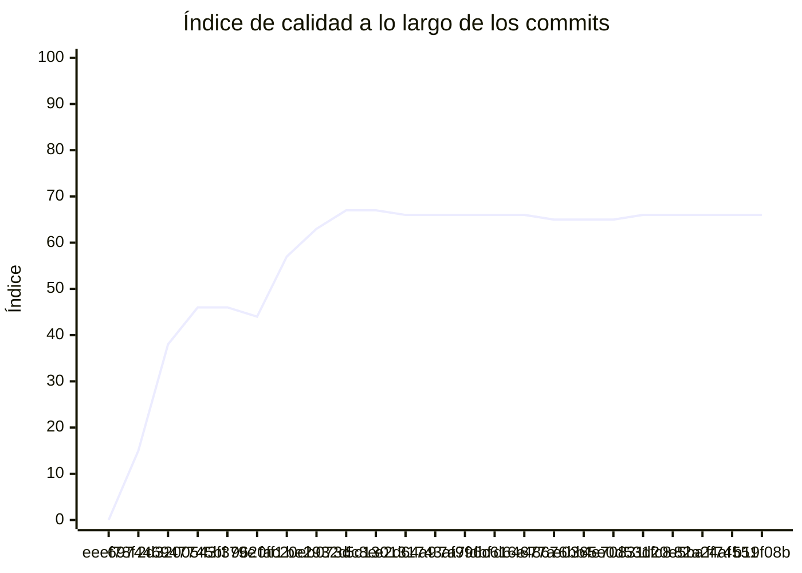

<!-- evaluacion:inicio -->
# Evaluación — prog-2-SQR/Backend-Turnos

> Documento **generado automáticamente** por la cátedra de Programación II (UM): RepoSense + análisis de calidad de **7 dimensiones**. **No editar a mano**: se regenera en cada evaluación.
> Rama evaluada: `main`. Análisis **heurístico** (regex + métricas) + build: es una criba para orientar la revisión, **no una nota**. La **documentación** del repositorio no se evalúa.
> Generado: 2026-11-17.

## 1. Veredicto

| Aspecto | Resultado |
|---|---|
| Índice de calidad | **77/100** |
| Tipo de repositorio | `backend` |
| Build (`mvnw verify` / `gradlew check`) | OK |
| Código (LOC) | 9,368 |
| Archivos de código | 230 |
| Clases | 236 |
| Código dentro de clases (%POO) | 58% |
| Funciones fuera de clases | 0 |
| Duplicación (puerta) | 0.6% |
| Duplicación lógica | 0.6% |
| Duplicación de boilerplate | 20.4% |
| Cobertura | 99% |
| Tope duro aplicado a D1 | `POO_BAJO` → D1 ≤ 60 |

> Este informe **describe** lo que el análisis midió con los criterios ya establecidos de la materia. No es una nota.

## 2. Semáforo de aprobación

Criterios de la cátedra (`CRITERIOS-CALIDAD.md`): **Aprobar** se juega con el perfil `estandar`; **destacar**, con el `exigente` (meta de excelencia).

| Semáforo | Resultado |
|---|---|
| Aprobar (`estandar`) | **no cumple** — 7/11 |
| Destacar (`exigente`) | **no cumple** — 6/11 |

**Para aprobar, falta cumplir:** SOLID

**Para destacar, falta cumplir:** SOLID; POO

## 3. Autoría (RepoSense)

| Autor | Commits | Código (LOC) | Tests (LOC) | Docs (LOC) | Días activos | % del código |
|---|---:|---:|---:|---:|---:|---:|
| Santiago Quiroga Rivarossa | 73 | 5,164 | 5,942 | 774 | 13 | 100% |

> _El LOC de autoría lo calcula RepoSense sobre el historial y puede diferir del LOC de código del análisis (que mira el estado de `main`)._

## 4. Dimensiones evaluadas

Cada dimensión indica **qué mide**, **por qué importa** y **tu resultado**. Cuando el puntaje queda por debajo de la referencia, se agregan preguntas para **investigar la causa** (no hay recetas).

| Dimensión | Peso | Puntaje |
|:--|--:|--:|
| **D1** Diseño OO, SOLID y patrones (20%) | 20% | 3 |
| **D2** Arquitectura hexagonal — backend (15%) | 15% | 100 |
| **D3** Frontend KMP: MVVM y buenas prácticas (10%) | 10% | N/A |
| **D4** Integración y contrato (10%) | 10% | 90 |
| **D5** Seguridad y robustez (10%) | 10% | 100 |
| **D6** Pruebas y cobertura (20%) | 20% | 100 |
| **D7** Proceso y entrega (15%) | 15% | 100 |

### D1. Diseño OO, SOLID y patrones (20%)

- **Qué mide:** Métricas orientadas a objetos (clases, métodos, campos, cohesión, acoplamiento, herencia) y proxies de SOLID, más patrones de diseño.
- **Por qué importa:** El eje de la materia es el buen uso de la POO y su arquitectura: un diseño con clases claras y poco acopladas es más fácil de entender, probar y cambiar.
- **Tu resultado:** **3/100**
- **Para investigar la causa:**
    - ¿Se pensó el modelo de clases antes de codificar o se agrupó después?
    - ¿Qué clases concentran muchas responsabilidades a la vez?
    - ¿Los colaboradores llegan como parámetros o se crean por dentro?

### D2. Arquitectura hexagonal — backend (15%)

- **Qué mide:** Separación en capas (dominio, puertos de entrada/salida, adaptadores) y dirección de las dependencias del backend.
- **Por qué importa:** Aislar el dominio de la infraestructura permite cambiar la base de datos, el framework o el transporte sin tocar las reglas de negocio.
- **Tu resultado:** **100/100**

### D4. Integración y contrato (10%)

- **Qué mide:** Cumplimiento del contrato de integración de la cátedra (formato de errores, paginación, autenticación, endpoints esperados).
- **Por qué importa:** Los servicios deben poder integrarse entre sí y con la app sin sorpresas; el contrato es lo que hacen cumplir las pruebas de integración.
- **Tu resultado:** **90/100**

### D5. Seguridad y robustez (10%)

- **Qué mide:** Credenciales embebidas, consultas SQL por concatenación, y presencia de config de entorno; aislamiento de secretos.
- **Por qué importa:** Un secreto en el repositorio o una consulta construida por concatenación son riesgos concretos, no hipotéticos.
- **Tu resultado:** **100/100**

### D6. Pruebas y cobertura (20%)

- **Qué mide:** Cantidad y resultado de pruebas y cobertura de línea (JaCoCo/Kover, Surefire/Failsafe) cuando hay build.
- **Por qué importa:** Las pruebas son la red de seguridad para refactorizar e integrar; la cobertura acota las zonas sin verificar.
- **Tu resultado:** **100/100**

### D7. Proceso y entrega (15%)

- **Qué mide:** Artefactos verificables de proceso/entrega: `compose`, `.env.example`, CI (`.github/workflows/`), `CODEOWNERS` y wrapper de build (`mvnw`/`gradlew`). **No** puntúa documentación.
- **Por qué importa:** Un proyecto que compila, se levanta y se valida solo es más fácil de revisar y de integrar en equipo.
- **Tu resultado:** **100/100**

## 5. Señales detectadas

El análisis encontró las siguientes señales (archivo, sin número de línea a propósito):

**DIP/concretos** (43)
- clase 'AuthenticationManagerCredentialsChecker' muy acoplada (CBO=14) — `src/main/java/ar/edu/um/prog2/quiroga/turnos/auth/infrastructure/security/AuthenticationManagerCredentialsChecker.java`
- clase 'JwtTokenIssuer' muy acoplada (CBO=17) — `src/main/java/ar/edu/um/prog2/quiroga/turnos/auth/infrastructure/security/JwtTokenIssuer.java`
- clase 'AuthController' muy acoplada (CBO=13) — `src/main/java/ar/edu/um/prog2/quiroga/turnos/auth/infrastructure/web/controller/AuthController.java`
- clase 'JpaReservationProcessRepositoryAdapter' muy acoplada (CBO=18) — `src/main/java/ar/edu/um/prog2/quiroga/turnos/reservation/infrastructure/persistence/adapter/JpaReservationProcessRepositoryAdapter.java`
- clase 'KafkaPhoneSubmissionPublisher' muy acoplada (CBO=15) — `src/main/java/ar/edu/um/prog2/quiroga/turnos/reservation/infrastructure/messaging/publisher/KafkaPhoneSubmissionPublisher.java`
- clase 'ReservationActionsListener' muy acoplada (CBO=24) — `src/main/java/ar/edu/um/prog2/quiroga/turnos/reservation/infrastructure/messaging/listener/ReservationActionsListener.java`
- clase 'CatedraHoldClientAdapter' muy acoplada (CBO=17) — `src/main/java/ar/edu/um/prog2/quiroga/turnos/reservation/infrastructure/client/adapter/CatedraHoldClientAdapter.java`
- clase 'CatedraErrors' muy acoplada (CBO=11) — `src/main/java/ar/edu/um/prog2/quiroga/turnos/reservation/infrastructure/client/adapter/CatedraErrors.java`
- clase 'CatedraReservationClientAdapter' muy acoplada (CBO=13) — `src/main/java/ar/edu/um/prog2/quiroga/turnos/reservation/infrastructure/client/adapter/CatedraReservationClientAdapter.java`
- clase 'ReservationController' muy acoplada (CBO=17) — `src/main/java/ar/edu/um/prog2/quiroga/turnos/reservation/infrastructure/web/controller/ReservationController.java`
- clase 'ReservationExceptionHandler' muy acoplada (CBO=29) — `src/main/java/ar/edu/um/prog2/quiroga/turnos/reservation/infrastructure/web/handler/ReservationExceptionHandler.java`
- clase 'ReservationService' muy acoplada (CBO=18) — `src/main/java/ar/edu/um/prog2/quiroga/turnos/reservation/application/service/ReservationService.java`
- clase 'CancelReservationUseCaseImpl' muy acoplada (CBO=16) — `src/main/java/ar/edu/um/prog2/quiroga/turnos/reservation/application/usecases/CancelReservationUseCaseImpl.java`
- clase 'StartReservationUseCaseImpl' muy acoplada (CBO=23) — `src/main/java/ar/edu/um/prog2/quiroga/turnos/reservation/application/usecases/StartReservationUseCaseImpl.java`
- clase 'StartReservationUseCaseImpl' instancia 3 concretos (CBO=23) — `src/main/java/ar/edu/um/prog2/quiroga/turnos/reservation/application/usecases/StartReservationUseCaseImpl.java`
- clase 'HandleReservationResultUseCaseImpl' muy acoplada (CBO=11) — `src/main/java/ar/edu/um/prog2/quiroga/turnos/reservation/application/usecases/HandleReservationResultUseCaseImpl.java`
- clase 'ReconcileReservationsUseCaseImpl' muy acoplada (CBO=9) — `src/main/java/ar/edu/um/prog2/quiroga/turnos/reservation/application/usecases/ReconcileReservationsUseCaseImpl.java`
- clase 'SubmitPhoneUseCaseImpl' muy acoplada (CBO=18) — `src/main/java/ar/edu/um/prog2/quiroga/turnos/reservation/application/usecases/SubmitPhoneUseCaseImpl.java`
- clase 'SubmitPhoneUseCaseImpl' instancia 3 concretos (CBO=18) — `src/main/java/ar/edu/um/prog2/quiroga/turnos/reservation/application/usecases/SubmitPhoneUseCaseImpl.java`
- clase 'HandlePhoneRequestUseCaseImpl' muy acoplada (CBO=12) — `src/main/java/ar/edu/um/prog2/quiroga/turnos/reservation/application/usecases/HandlePhoneRequestUseCaseImpl.java`
- clase 'ReservationProcessRepository' muy acoplada (CBO=9) — `src/main/java/ar/edu/um/prog2/quiroga/turnos/reservation/domain/ports/out/ReservationProcessRepository.java`
- clase 'ReservationResultType' muy acoplada (CBO=12) — `src/main/java/ar/edu/um/prog2/quiroga/turnos/reservation/domain/model/ReservationResultType.java`
- clase 'ReservationProcess' muy acoplada (CBO=34) — `src/main/java/ar/edu/um/prog2/quiroga/turnos/reservation/domain/model/ReservationProcess.java`
- clase 'ReservationStatus' muy acoplada (CBO=19) — `src/main/java/ar/edu/um/prog2/quiroga/turnos/reservation/domain/model/ReservationStatus.java`
- clase 'CatalogClientAdapter' muy acoplada (CBO=18) — `src/main/java/ar/edu/um/prog2/quiroga/turnos/availability/infrastructure/client/adapter/CatalogClientAdapter.java`
- clase 'CatedraOccupancyClientAdapter' muy acoplada (CBO=13) — `src/main/java/ar/edu/um/prog2/quiroga/turnos/availability/infrastructure/client/adapter/CatedraOccupancyClientAdapter.java`
- clase 'AvailabilityController' muy acoplada (CBO=13) — `src/main/java/ar/edu/um/prog2/quiroga/turnos/availability/infrastructure/web/controller/AvailabilityController.java`
- clase 'AvailabilityExceptionHandler' muy acoplada (CBO=16) — `src/main/java/ar/edu/um/prog2/quiroga/turnos/availability/infrastructure/web/handler/AvailabilityExceptionHandler.java`
- clase 'GetAvailabilityUseCaseImpl' muy acoplada (CBO=17) — `src/main/java/ar/edu/um/prog2/quiroga/turnos/availability/application/usecases/GetAvailabilityUseCaseImpl.java`
- clase 'GetAvailabilityUseCaseImpl' instancia 3 concretos (CBO=17) — `src/main/java/ar/edu/um/prog2/quiroga/turnos/availability/application/usecases/GetAvailabilityUseCaseImpl.java`
- clase 'WeeklySchedule' muy acoplada (CBO=9) — `src/main/java/ar/edu/um/prog2/quiroga/turnos/availability/domain/model/WeeklySchedule.java`
- clase 'Availability' muy acoplada (CBO=8) — `src/main/java/ar/edu/um/prog2/quiroga/turnos/availability/domain/model/Availability.java`
- clase 'HttpClientsConfig' muy acoplada (CBO=30) — `src/main/java/ar/edu/um/prog2/quiroga/turnos/config/HttpClientsConfig.java`
- clase 'HttpClientsConfig' instancia 3 concretos (CBO=30) — `src/main/java/ar/edu/um/prog2/quiroga/turnos/config/HttpClientsConfig.java`
- clase 'JwtConfig' muy acoplada (CBO=17) — `src/main/java/ar/edu/um/prog2/quiroga/turnos/shared/security/JwtConfig.java`
- clase 'JwtConfig' instancia 5 concretos (CBO=17) — `src/main/java/ar/edu/um/prog2/quiroga/turnos/shared/security/JwtConfig.java`
- clase 'SecurityConfig' muy acoplada (CBO=15) — `src/main/java/ar/edu/um/prog2/quiroga/turnos/shared/security/SecurityConfig.java`
- clase 'GlobalExceptionHandler' muy acoplada (CBO=23) — `src/main/java/ar/edu/um/prog2/quiroga/turnos/shared/web/GlobalExceptionHandler.java`
- clase 'UserDetailsServiceAdapter' muy acoplada (CBO=11) — `src/main/java/ar/edu/um/prog2/quiroga/turnos/user/infrastructure/security/UserDetailsServiceAdapter.java`
- clase 'UserController' muy acoplada (CBO=11) — `src/main/java/ar/edu/um/prog2/quiroga/turnos/user/infrastructure/web/controller/UserController.java`
- clase 'UserExceptionHandler' muy acoplada (CBO=9) — `src/main/java/ar/edu/um/prog2/quiroga/turnos/user/infrastructure/web/handler/UserExceptionHandler.java`
- clase 'RegisterUserUseCaseImpl' muy acoplada (CBO=15) — `src/main/java/ar/edu/um/prog2/quiroga/turnos/user/application/usecases/RegisterUserUseCaseImpl.java`
- clase 'RegisterUserUseCaseImpl' instancia 3 concretos (CBO=15) — `src/main/java/ar/edu/um/prog2/quiroga/turnos/user/application/usecases/RegisterUserUseCaseImpl.java`

**OCP/type-switch** (6)
- clase 'AuthenticationManagerCredentialsChecker' con 1 type-checks — `src/main/java/ar/edu/um/prog2/quiroga/turnos/auth/infrastructure/security/AuthenticationManagerCredentialsChecker.java`
- clase 'CatedraErrors' con 1 type-checks — `src/main/java/ar/edu/um/prog2/quiroga/turnos/reservation/infrastructure/client/adapter/CatedraErrors.java`
- clase 'CatalogClientAdapter' con 2 type-checks — `src/main/java/ar/edu/um/prog2/quiroga/turnos/availability/infrastructure/client/adapter/CatalogClientAdapter.java`
- clase 'CatedraOccupancyClientAdapter' con 1 type-checks — `src/main/java/ar/edu/um/prog2/quiroga/turnos/availability/infrastructure/client/adapter/CatedraOccupancyClientAdapter.java`
- clase 'TokenRelayInterceptor' con 1 type-checks — `src/main/java/ar/edu/um/prog2/quiroga/turnos/shared/security/TokenRelayInterceptor.java`
- clase 'GlobalExceptionHandler' con 2 type-checks — `src/main/java/ar/edu/um/prog2/quiroga/turnos/shared/web/GlobalExceptionHandler.java`

**SRP/responsabilidad** (33)
- clase 'ReservationProcessEntity' grande (LOC=37, métodos=0, campos=18) — `src/main/java/ar/edu/um/prog2/quiroga/turnos/reservation/infrastructure/persistence/entity/ReservationProcessEntity.java`
- clase 'PhoneSubmissionEntity' grande (LOC=20, métodos=0, campos=9) — `src/main/java/ar/edu/um/prog2/quiroga/turnos/reservation/infrastructure/persistence/entity/PhoneSubmissionEntity.java`
- clase 'ReservationActionsListener' grande (LOC=64, métodos=9, campos=8) — `src/main/java/ar/edu/um/prog2/quiroga/turnos/reservation/infrastructure/messaging/listener/ReservationActionsListener.java`
- clase 'ReservationActionsListener' con baja cohesión (8%) — `src/main/java/ar/edu/um/prog2/quiroga/turnos/reservation/infrastructure/messaging/listener/ReservationActionsListener.java`
- clase 'PhoneSubmittedMessage' grande (LOC=21, métodos=0, campos=12) — `src/main/java/ar/edu/um/prog2/quiroga/turnos/reservation/infrastructure/messaging/dto/PhoneSubmittedMessage.java`
- clase 'ReservationActionMessage' grande (LOC=15, métodos=0, campos=11) — `src/main/java/ar/edu/um/prog2/quiroga/turnos/reservation/infrastructure/messaging/dto/ReservationActionMessage.java`
- clase 'CatedraHoldClientAdapter' con baja cohesión (30%) — `src/main/java/ar/edu/um/prog2/quiroga/turnos/reservation/infrastructure/client/adapter/CatedraHoldClientAdapter.java`
- clase 'ReservationResponse' grande (LOC=16, métodos=0, campos=10) — `src/main/java/ar/edu/um/prog2/quiroga/turnos/reservation/infrastructure/web/dto/ReservationResponse.java`
- clase 'ReservationService' grande (LOC=39, métodos=10, campos=9) — `src/main/java/ar/edu/um/prog2/quiroga/turnos/reservation/application/service/ReservationService.java`
- clase 'ReservationService' con baja cohesión (4%) — `src/main/java/ar/edu/um/prog2/quiroga/turnos/reservation/application/service/ReservationService.java`
- clase 'ReservationException' grande (LOC=36, métodos=2, campos=21) — `src/main/java/ar/edu/um/prog2/quiroga/turnos/reservation/application/exception/ReservationException.java`
- clase 'CatedraReservation' sin métodos (3 campos): solo datos — `src/main/java/ar/edu/um/prog2/quiroga/turnos/reservation/domain/model/CatedraReservation.java`
- clase 'ReservationProcess' grande (LOC=177, métodos=22, campos=23) — `src/main/java/ar/edu/um/prog2/quiroga/turnos/reservation/domain/model/ReservationProcess.java`
- clase 'ReservationProcess' con baja cohesión (28%) — `src/main/java/ar/edu/um/prog2/quiroga/turnos/reservation/domain/model/ReservationProcess.java`
- clase 'Patient' con baja cohesión (20%) — `src/main/java/ar/edu/um/prog2/quiroga/turnos/reservation/domain/model/Patient.java`
- clase 'Hold' sin métodos (3 campos): solo datos — `src/main/java/ar/edu/um/prog2/quiroga/turnos/reservation/domain/model/Hold.java`
- clase 'ReservationResult' sin métodos (7 campos): solo datos — `src/main/java/ar/edu/um/prog2/quiroga/turnos/reservation/domain/model/ReservationResult.java`
- clase 'PhoneSubmission' grande (LOC=32, métodos=4, campos=10) — `src/main/java/ar/edu/um/prog2/quiroga/turnos/reservation/domain/model/PhoneSubmission.java`
- clase 'PhoneSubmission' con baja cohesión (17%) — `src/main/java/ar/edu/um/prog2/quiroga/turnos/reservation/domain/model/PhoneSubmission.java`
- clase 'CatalogClientAdapter' con baja cohesión (43%) — `src/main/java/ar/edu/um/prog2/quiroga/turnos/availability/infrastructure/client/adapter/CatalogClientAdapter.java`
- clase 'Availability' sin métodos (3 campos): solo datos — `src/main/java/ar/edu/um/prog2/quiroga/turnos/availability/domain/model/Availability.java`
- clase 'CatedraProperties' sin métodos (6 campos): solo datos — `src/main/java/ar/edu/um/prog2/quiroga/turnos/config/CatedraProperties.java`
- clase 'CatalogoProperties' sin métodos (5 campos): solo datos — `src/main/java/ar/edu/um/prog2/quiroga/turnos/config/CatalogoProperties.java`
- clase 'PhoneOutboxProperties' sin métodos (4 campos): solo datos — `src/main/java/ar/edu/um/prog2/quiroga/turnos/config/PhoneOutboxProperties.java`
- clase 'JwtConfig' con baja cohesión (40%) — `src/main/java/ar/edu/um/prog2/quiroga/turnos/shared/security/JwtConfig.java`
- clase 'JwtProperties' sin métodos (3 campos): solo datos — `src/main/java/ar/edu/um/prog2/quiroga/turnos/shared/security/JwtProperties.java`
- clase 'ApiFieldError' sin métodos (3 campos): solo datos — `src/main/java/ar/edu/um/prog2/quiroga/turnos/shared/web/ApiFieldError.java`
- clase 'UserEntity' grande (LOC=32, métodos=0, campos=14) — `src/main/java/ar/edu/um/prog2/quiroga/turnos/user/infrastructure/persistence/entity/UserEntity.java`
- clase 'AccountResponse' grande (LOC=15, métodos=0, campos=13) — `src/main/java/ar/edu/um/prog2/quiroga/turnos/user/infrastructure/web/dto/AccountResponse.java`
- clase 'RegisterUserRequest' grande (LOC=23, métodos=0, campos=8) — `src/main/java/ar/edu/um/prog2/quiroga/turnos/user/infrastructure/web/dto/RegisterUserRequest.java`
- clase 'RegisterUserUseCaseImpl' con baja cohesión (17%) — `src/main/java/ar/edu/um/prog2/quiroga/turnos/user/application/usecases/RegisterUserUseCaseImpl.java`
- clase 'User' grande (LOC=17, métodos=0, campos=14) — `src/main/java/ar/edu/um/prog2/quiroga/turnos/user/domain/model/User.java`
- clase 'User' sin métodos (14 campos): solo datos — `src/main/java/ar/edu/um/prog2/quiroga/turnos/user/domain/model/User.java`

**POO** (3)
- clase 'ReservationException' con 20 campos públicos (encapsulación) — `src/main/java/ar/edu/um/prog2/quiroga/turnos/reservation/application/exception/ReservationException.java`
- clase 'AvailabilityException' con 6 campos públicos (encapsulación) — `src/main/java/ar/edu/um/prog2/quiroga/turnos/availability/application/exception/AvailabilityException.java`
- clase 'UserException' con 4 campos públicos (encapsulación) — `src/main/java/ar/edu/um/prog2/quiroga/turnos/user/application/exception/UserException.java`

## 6. Evolución por commit

Métricas calculadas sobre el estado de `main` en **cada commit** (23 commits con trabajo), del primero al último. La calidad usa el perfil `exigente`; el aporte de código lo mide RepoSense. El índice puede **bajar** al crecer el proyecto: se acumulan señales.

| # | Fecha | Commit | Autor | LOC | Índice | %POO | Duplic. | Sueltas |
|---|---|---|---|---:|---:|---:|---:|---:|
| 1 | 2026-09-10 | `eeef78f` | Ing. Daniel Quinteros | 0 | 0 | 0% | 0.0% | 0 |
| 2 | 2026-09-10 | `6974469` | Ing. Daniel Quinteros | 0 | 15 | 0% | 0.0% | 0 |
| 3 | 2026-10-16 | `2d32005` | Santiago Quiroga Rivarossa | 18 | 38 | 56% | 0.0% | 0 |
| 4 | 2026-10-18 | `47745bf` | Santiago Quiroga Rivarossa | 34 | 46 | 56% | 0.0% | 0 |
| 5 | 2026-10-19 | `43f379e` | Santiago Quiroga Rivarossa | 34 | 46 | 56% | 0.0% | 0 |
| 6 | 2026-10-23 | `9620ff1` | Santiago Quiroga Rivarossa | 222 | 44 | 61% | 0.0% | 0 |
| 7 | 2026-10-23 | `fac20eb` | Santiago Quiroga Rivarossa | 1,015 | 57 | 61% | 0.0% | 0 |
| 8 | 2026-10-24 | `be2932d` | Santiago Quiroga Rivarossa | 1,942 | 63 | 56% | 0.0% | 0 |
| 9 | 2026-10-24 | `073dc8e` | Santiago Quiroga Rivarossa | 2,050 | 67 | 57% | 0.0% | 0 |
| 10 | 2026-10-27 | `5c13013` | Santiago Quiroga Rivarossa | 2,068 | 67 | 56% | 0.0% | 0 |
| 11 | 2026-10-28 | `e2d64a9` | Santiago Quiroga Rivarossa | 3,749 | 66 | 56% | 0.0% | 0 |
| 12 | 2026-10-29 | `1743af9` | Santiago Quiroga Rivarossa | 3,749 | 66 | 56% | 0.0% | 0 |
| 13 | 2026-10-29 | `7a7fdbf` | Santiago Quiroga Rivarossa | 3,782 | 66 | 56% | 0.0% | 0 |
| 14 | 2026-10-29 | `96c616e` | Santiago Quiroga Rivarossa | 3,788 | 66 | 56% | 0.0% | 0 |
| 15 | 2026-10-29 | `d64677a` | Santiago Quiroga Rivarossa | 5,955 | 66 | 57% | 0.4% | 0 |
| 16 | 2026-10-29 | `48676bb` | Santiago Quiroga Rivarossa | 6,709 | 65 | 58% | 0.3% | 0 |
| 17 | 2026-11-02 | `e0365e0` | Santiago Quiroga Rivarossa | 6,709 | 65 | 58% | 0.3% | 0 |
| 18 | 2026-11-02 | `4e70831` | Santiago Quiroga Rivarossa | 8,269 | 65 | 59% | 0.3% | 0 |
| 19 | 2026-11-02 | `d531fc8` | Santiago Quiroga Rivarossa | 8,502 | 66 | 58% | 0.2% | 0 |
| 20 | 2026-11-02 | `d20e5ba` | Santiago Quiroga Rivarossa | 8,918 | 66 | 58% | 0.6% | 0 |
| 21 | 2026-11-02 | `82a24af` | Santiago Quiroga Rivarossa | 9,368 | 66 | 58% | 0.6% | 0 |
| 22 | 2026-11-04 | `ff74551` | Santiago Quiroga Rivarossa | 9,368 | 66 | 58% | 0.6% | 0 |
| 23 | 2026-11-04 | `b19f08b` | Santiago Quiroga Rivarossa | 9,368 | 66 | 58% | 0.6% | 0 |

---
_Informe generado por la cátedra. Las dimensiones y umbrales corresponden a `calidad.py` (perfil `exigente`); el semáforo, a `CRITERIOS-CALIDAD.md`. La documentación del repositorio no se evalúa. Ante dudas, revisá el archivo señalado._
<!-- evaluacion:fin -->
