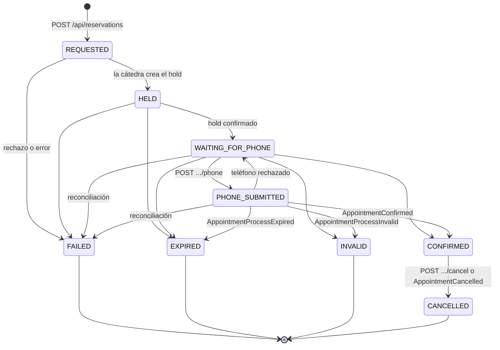
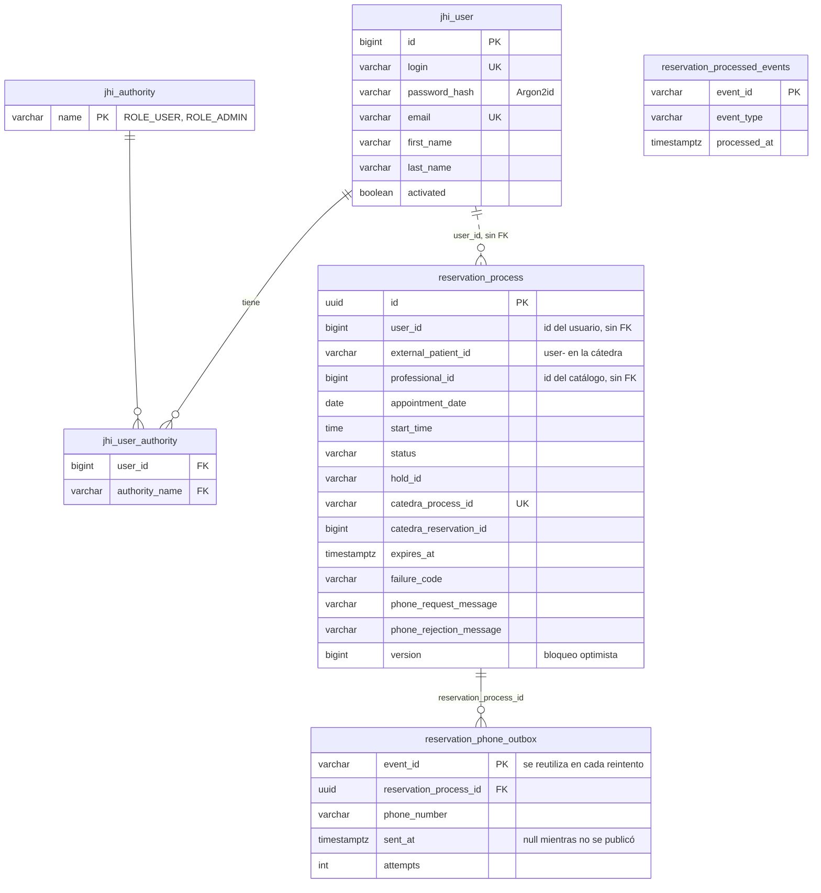

# SPEC: Backend-Turnos

Qué hace el servicio, con qué contrato y con qué datos. El cómo se construyó está en [PLAN.md](PLAN.md), y el detalle de cada tarea, en [TASKS.md](TASKS.md).

## Propósito

Servicio de **usuarios y reservas** de la app de turnos. Registra y autentica a los usuarios finales, calcula los turnos libres de un profesional y lleva adelante el proceso de reserva con el servicio de la cátedra (hold, confirmación, teléfono por Kafka y resultado), hasta su estado final.

Es dueño exclusivo de su base de datos (enunciado §3). No guarda una copia del catálogo: lo consulta al servicio de catálogo en cada operación (enunciado §4.2).

## Requisitos que cubre

Enunciado §5:

| Punto | Requisito | Dónde |
|---|---|---|
| 1 | Registrar y autenticar a cada usuario final | `user`, `auth` |
| 8 | Construir los turnos disponibles con los horarios semanales y las ocupaciones | `availability` |
| 9 y 10 | Pedir el hold y confirmar la reserva por REST | `reservation` |
| 11 | Recibir el pedido de teléfono por Kafka y responderlo | `reservation` (listener y outbox) |
| 12 | Reflejar el resultado final | `reservation` (listener de resultados) |
| 13 | Consultar las reservas propias | `reservation` |
| 14 | Cancelar una reserva propia confirmada | `reservation` |
| 15 | Informar errores de integración y recuperarse sin corromper el estado | `problem+json`, máquina de estados, reconciliación |

## Casos de uso

Los mismos códigos que en [Documentacion/casos-de-uso/turnos.md](https://github.com/prog-2-SQR/Documentacion/blob/main/casos-de-uso/turnos.md), donde está el detalle de cada uno.

| Código | Caso de uso | Disparador |
|---|---|---|
| CU-TUR-01 | Registrar un usuario | `POST /api/register` |
| CU-TUR-02 | Iniciar sesión y obtener un JWT (y ver la cuenta propia) | `POST /api/authenticate`, `GET /api/account` |
| CU-TUR-03 | Ver los turnos libres de un profesional en un día | `GET /api/availability` |
| CU-TUR-04 | Iniciar una reserva: revalidar el turno y pedir el hold | `POST /api/reservations` |
| CU-TUR-05 | Confirmar el hold; la cátedra pide el teléfono | `POST /api/reservations` y Kafka `AdditionalInformationRequested` |
| CU-TUR-06 | Enviar el teléfono | `POST /api/reservations/{id}/phone` → outbox → Kafka |
| CU-TUR-07 | Aplicar el resultado del proceso | Kafka: confirmada, teléfono rechazado, vencida, inválida o cancelada |
| CU-TUR-08 | Consultar las reservas propias | `GET /api/reservations`, `GET /api/reservations/{id}` |
| CU-TUR-09 | Cancelar una reserva propia confirmada | `POST /api/reservations/{id}/cancel` |
| CU-TUR-10 | Recuperar los procesos que quedaron en curso | Reconciliación programada (al arrancar y cada 5 min) |

## API

Todas las rutas, salvo registro, login y health, piden `Authorization: Bearer <id_token>`. Sin token o con uno inválido responden `401`. Los errores salen como `application/problem+json` con un `code` (anexo §13).

| Método y ruta | Respuesta | Errores principales |
|---|---|---|
| `POST /api/register` | `201` | `400 USERNAME_ALREADY_EXISTS`, `EMAIL_ALREADY_EXISTS`, `INVALID_PASSWORD`, `VALIDATION_ERROR` |
| `POST /api/authenticate` | `200 {"id_token": "..."}` | `401 BAD_CREDENTIALS` |
| `GET /api/account` | `200`, usuario sin la contraseña | `401` |
| `GET /api/availability?professionalId&date` | `200 {professionalId, date, slots[]}` | `400 INVALID_DATE`, `400 PROFESSIONAL_DISABLED`, `404 PROFESSIONAL_NOT_FOUND`, `503 CATALOG_UNAVAILABLE`, `503 CATEDRA_UNAVAILABLE` |
| `POST /api/reservations` | `201`, proceso en `WAITING_FOR_PHONE` | `409 RESERVATION_ALREADY_PENDING`, `409 SLOT_NOT_AVAILABLE`, `400 PATIENT_NAME_REQUIRED`, códigos de la cátedra (`SLOT_ALREADY_HELD`, `INVALID_SLOT`…) |
| `GET /api/reservations?page&size` | `200 {content, page, size, totalElements, totalPages}` | `400` si `size` no está entre 1 y 100 |
| `GET /api/reservations/{id}` | `200`, el proceso | `404 RESERVATION_NOT_FOUND` (también si es de otro usuario) |
| `POST /api/reservations/{id}/phone` | `202`, proceso en `PHONE_SUBMITTED` | `400 INVALID_PHONE_NUMBER`, `409 PHONE_NOT_REQUESTED` |
| `POST /api/reservations/{id}/cancel` | `200`, proceso en `CANCELLED` | `409 RESERVATION_NOT_CANCELLABLE`, `503 CATEDRA_UNAVAILABLE` |
| `GET /actuator/health` | `200 {"status": "UP"}` | — |

El contrato con el catálogo (qué consulta Turnos y con qué token) está en [Documentacion/contratos/turnos-catalogo.md](https://github.com/prog-2-SQR/Documentacion/blob/main/contratos/turnos-catalogo.md).

## Proceso de reserva

Reglas:
- **Un estado final no cambia más**, y `CONFIRMED` solo puede pasar a `CANCELLED`. Todo cambio pasa por `ReservationStatus.canMoveTo`: un evento tardío o repetido nunca hace retroceder un proceso (anexo §18.3).
- **Una reserva en curso por usuario** (`REQUESTED` a `PHONE_SUBMITTED`). Lo garantiza un índice único parcial en PostgreSQL.
- **Cada usuario ve y cancela solo lo suyo**: las consultas filtran por el usuario del token, y una reserva ajena responde `404`, igual que una inexistente.
- **Idempotencia**: un evento de Kafka con un `eventId` ya procesado no tiene efecto. El teléfono se reintenta con el mismo `eventId`.

## Modelo de datos

Base PostgreSQL propia (`turnos`), con el esquema creado por Liquibase (`src/main/resources/db/changelog/`).

**Propiedad de los datos:**
- Los usuarios (`jhi_*`) y los procesos de reserva son de Turnos. Ningún otro servicio lee estas tablas.
- `user_id` es una **referencia por id** al slice `user`, sin FK: cada slice es dueño de sus tablas (ADR 0004).
- `professional_id` también es una referencia por id, en este caso al catálogo, sin FK ni copia: el nombre, el estado y los horarios se piden al catálogo cuando hacen falta.
- La cátedra es la fuente de verdad de las ocupaciones y del resultado de cada proceso. Turnos guarda su propio estado local y lo pone al día con los eventos y la reconciliación.

## Requisitos no funcionales

- **Seguridad** ([ADR 0007](adr/0007-autenticacion-y-autorizacion.md)): JWT HS512 firmado por Turnos, contraseñas con Argon2id, sesiones sin estado, secretos solo por variables de entorno, y errores que no exponen detalles internos.
- **Resiliencia**: timeouts y reintentos limitados contra el catálogo y la cátedra; si no responden, la operación no se inicia (`503`). El outbox asegura que el teléfono no se pierda si Kafka está caído. La reconciliación recupera los procesos que quedaron en curso.
- **Pruebas**: unitarias de cada caso de uso, de controllers con MockMvc, y de integración con Testcontainers (PostgreSQL y Kafka) y WireMock (catálogo y cátedra). Cobertura con JaCoCo, y análisis con SonarQube Cloud en el CI.
